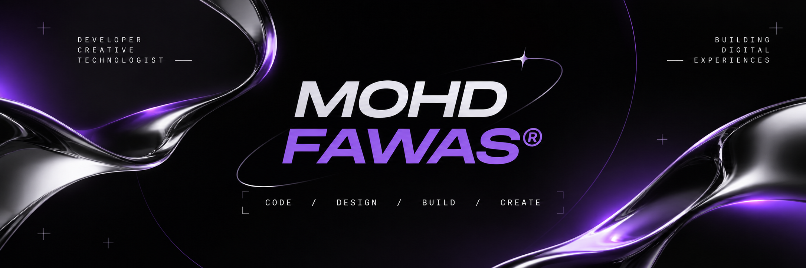

  

# MOHD FAWAS®

  

### Developer · Creative Technologist · Digital Creator

Building digital experiences through code, creativity and experimentation.

---

## ABOUT ME

I'm Mohd Fawas, a developer passionate about creating modern web applications, exploring technology and transforming ideas into meaningful digital products.

- Building full-stack web applications
- Exploring creative technologies
- Learning, experimenting and developing new ideas
- Focused on clean interfaces and useful digital experiences

## TECH STACK

**Frontend**

**Backend & Database**

**Tools**

## FEATURED PROJECTS

### 01 — SKILLORA

A campus skill-sharing platform that connects students and allows them to exchange knowledge and skills.

**Built with:** React · Flask · PostgreSQL · Python

[Live Project](https://skillora-hazel-six.vercel.app/) · [GitHub Repository](https://github.com/fawaas/Skillora)

### 02 — CALCORA

A modern collection of calculators and digital conversion utilities.

[Live Project](https://calcora.vercel.app/) · [GitHub Repository](https://github.com/fawaas/Calcora)

---

## GITHUB ACTIVITY

---

## LET'S CONNECT

[GitHub](https://github.com/fawaas) · [LinkedIn](https://www.linkedin.com/in/mohammed-fawas-bb6140318/) · [Instagram](https://instagram.com/ft.fawaas/) · [Email](mailto:itsmefawaas@gmail.com)

**THINK. CREATE. BUILD.**

*Building digital experiences. One idea at a time.*

© 2026 MOHD FAWAS®

<!--
**fawaas/fawaas** is a ✨ _special_ ✨ repository because its `README.md` (this file) appears on your GitHub profile.

Here are some ideas to get you started:

- 🔭 I’m currently working on ...
- 🌱 I’m currently learning ...
- 👯 I’m looking to collaborate on ...
- 🤔 I’m looking for help with ...
- 💬 Ask me about ...
- 📫 How to reach me: ...
- 😄 Pronouns: ...
- ⚡ Fun fact: ...
-->
